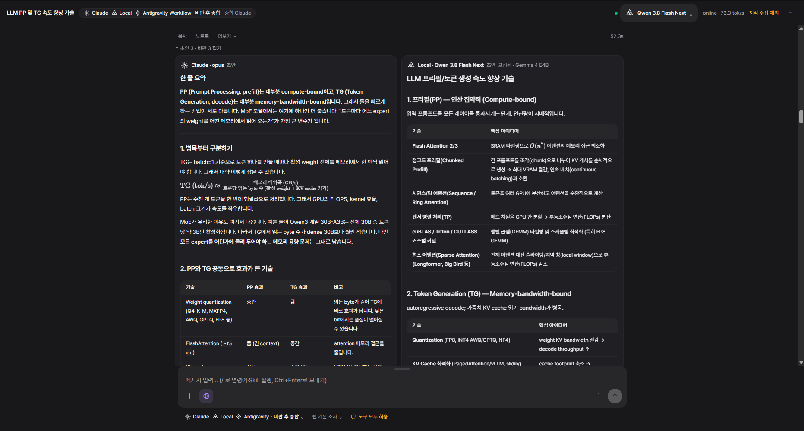
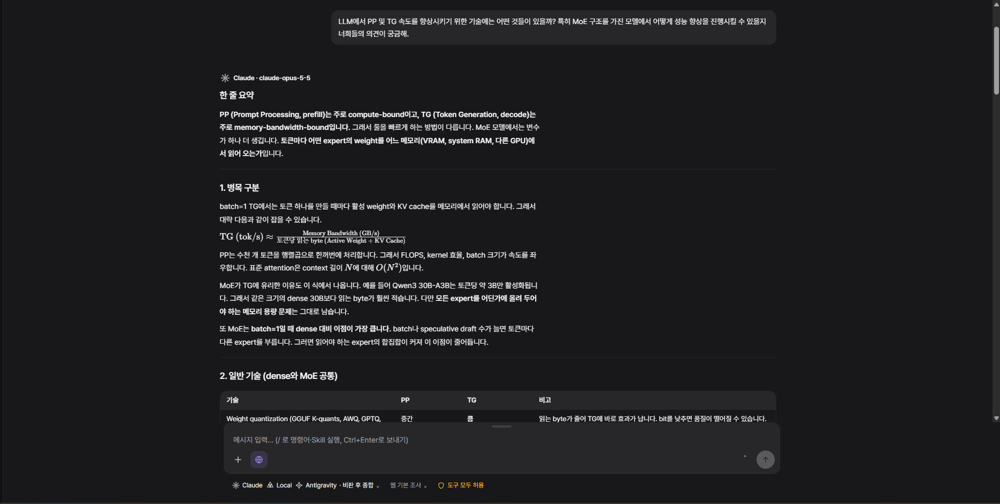

<h1 align="center">Prism</h1>

<p align="center"><b>여러 AI에게 같은 질문을 맡기고, 서로 검증하게 합니다.</b></p>

<p align="center">
  <a href="README.md">English</a> · <a href="README.ko.md">한국어</a>
</p>

<p align="center">
  <a href="https://github.com/minami-nam/prism/releases/latest"></a>
  
  <a href="LICENSE.md"></a>
</p>

Prism은 내 PC에서 돌아가는 개인용 AI 작업대입니다. local model이나 이미 구독 중인 coding agent
(Claude Code, Codex, Antigravity)와 대화하고, 여러 agent에게 같은 질문을 맡겨 서로의 답을 비판하게 하고,
그 주장을 실제로 실행한 도구의 결과로 확인할 수 있습니다.

<p align="center">
  
</p>

## 기능

| | |
| --- | --- |
| **Solo 대화** | 메시지마다 provider·model·생각 단계를 고릅니다. 대화 중간에 local model에서 구독 agent로 바꿀 수 있습니다. |
| **Multi·Workflow** | 여러 agent가 초안을 쓰고 서로의 초안을 비판한 뒤, 한 agent가 최종 답을 씁니다. agent마다 persona를 따로 줄 수 있습니다. |
| **교차 검증** | 여러 agent가 같은 코드를 따로 검토하고, 지적을 묶어 투표한 뒤, 실제 도구(Verilator, Yosys, ruff, pytest, mypy)로 확인합니다. 모든 수정안은 사용자가 승인합니다. |
| **지식** | 내 Markdown 노트, 표, 문서를 찾을 수 있는 지식으로 만들고, 답에는 참고한 부분이 표시됩니다. |
| **나에 대해** | 대화에서 오래 유지될 내 선호를 배우고, 답마다 어떤 정보를 참고했는지 보여 줍니다. |
| **도구** | 노트, project 코드, 웹 검색과 browser, 내 PC의 파일과 명령, 스마트홈 기기를 MCP로 씁니다. 쓰기 작업은 승인을 받은 뒤 실행합니다. |
| **Code 작업대** | agent와 함께 project를 고치고, 변경을 하나씩 수락하거나 거절하며, 차례마다 자동 검사 결과를 봅니다. |
| **Hub** | 계정, 그룹의 local model 공유, 여러 PC 사이의 대화·노트 동기화를 위한 선택 서버입니다. |

답마다 실제로 실행된 도구, 각 호출의 승인 여부, 오류가 표시됩니다. 기록이 없으면 도구를 쓰지 않은 것입니다.

<details>
<summary>서로의 초안을 비판한 뒤 나온 최종 답</summary>
<p align="center"></p>
</details>

## 설치

### Windows

[최신 릴리스](https://github.com/minami-nam/prism/releases/latest)에서 `Prism-Install-<version>.exe`를 받아 실행합니다.
업데이트는 같은 릴리스 페이지에서 자동으로 받습니다.

아직 코드 서명이 없어서 Windows SmartScreen이 확인을 요청할 수 있습니다.

### Linux

Ubuntu 24.04, x86_64. `x.y.z`를 최신 릴리스 버전으로 바꿉니다.

```sh
bash -o pipefail -c 'curl --proto "=https" --proto-redir "=https" -fLsS "https://github.com/minami-nam/prism/releases/download/v$1/install.sh" | sh' _ x.y.z
"${XDG_DATA_HOME:-$HOME/.local/share}/prism/current/prism"
```

`PRISM_READY` 줄에 나온 `url`을 브라우저에서 엽니다. 설치 스크립트는 받은 파일을 내장된 SHA-256과 대조합니다.
업데이트할 때는 새 버전으로 설치 명령을 다시 실행합니다.

### Hub (선택)

여러 사람이나 여러 PC가 Prism을 함께 쓸 때 Hub를 띄웁니다.

```sh
docker run -d --name prism-hub --restart unless-stopped \
  -p 127.0.0.1:8790:8790 \
  -e HUB_PUBLIC_URL=https://hub.example.com \
  -e HUB_FORWARDED_ALLOW_IPS='*' \
  -v prism-hub:/data \
  ghcr.io/minami-nam/prism-hub:latest
```

HTTPS reverse proxy(Caddy, nginx, Cloudflare Tunnel) 뒤에 둡니다. 첫 관리자를 만드는 주소는 `docker logs prism-hub`에 나옵니다.

## 필요한 것

- **구독 agent:** Prism을 실행하는 PC에 Claude Code, Codex, Antigravity를 설치하고 로그인합니다.
  기존 구독을 그대로 쓰며 API 요금이 따로 들지 않습니다.
- **local model:** llama.cpp `llama-server` 같은 OpenAI 호환 서버. 지식 검색과 '나에 대해'의 관련 정보 고르기에는
  embedding model도 필요합니다.
- **교차 검증 도구:** 쓰려는 도구(Verilator, Yosys, ruff, pytest, mypy)를 설치합니다.

## 개인 정보

Prism은 설정, 대화, 노트를 실행하는 기기에 저장합니다. Hub 동기화를 켜거나 구독 agent에게 대화를 보낼 때만
밖으로 나갑니다. 노트와 '나에 대해'를 구독 agent의 답에도 붙일지는 설정이며, 기본은 꺼져 있습니다.

## 라이선스

[Apache-2.0](LICENSE.md)
