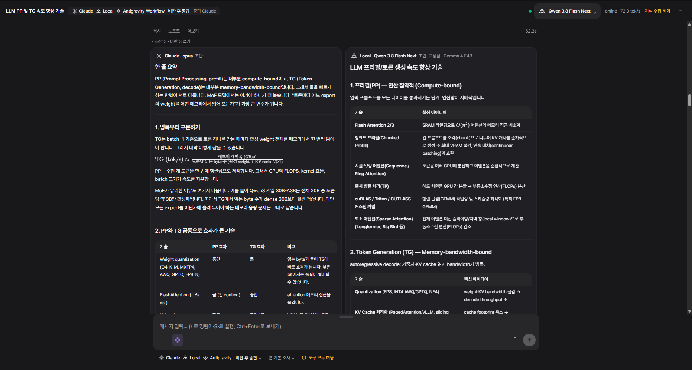
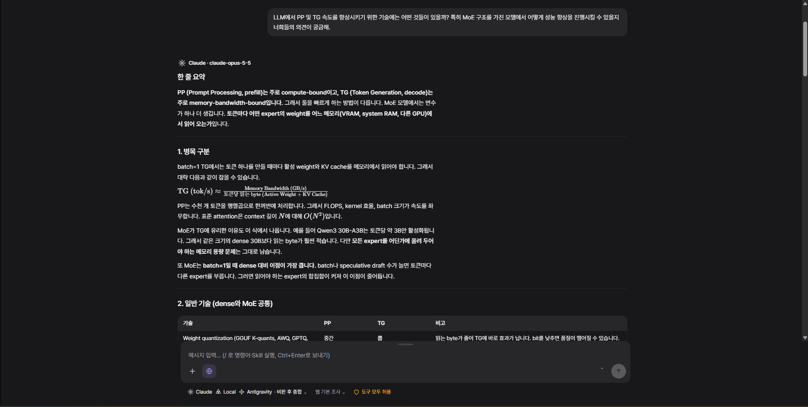

<h1 align="center">Prism</h1>

<p align="center"><b>Put several AIs on the same question — and make them check each other.</b></p>

<p align="center">
  <a href="README.md">English</a> · <a href="README.ko.md">한국어</a>
</p>

<p align="center">
  <a href="https://github.com/minami-nam/prism/releases/latest"></a>
  
  <a href="LICENSE.md"></a>
</p>

Prism is a personal AI workbench that runs on your own PC. You can chat with a local model or
with the coding agents you already subscribe to (Claude Code, Codex, Antigravity), have several
of them answer and critique each other, and check their claims against tools that actually ran.

<p align="center">
  
</p>

## Features

| | |
| --- | --- |
| **Solo chat** | Pick the provider, model and thinking level for each message. Switch from a local model to a hosted agent mid-conversation. |
| **Multi & Workflow** | Several agents draft, critique each other's drafts, and one writes the final answer. Give each agent its own persona. |
| **Cross-validation** | Agents review the same code independently, findings are grouped and voted on, and real tools (Verilator, Yosys, ruff, pytest, mypy) confirm them. You approve every patch. |
| **Knowledge** | Your Markdown notes, spreadsheets and documents become searchable knowledge, and answers cite the parts they used. |
| **About me** | Prism learns lasting preferences from your conversations and shows, under each answer, which ones it used. |
| **Tools** | Notes, project code, web search and browser, local files and commands, and smart-home devices through MCP. Write actions wait for your approval. |
| **Code workbench** | Edit a project with an agent, accept or reject each change, and see automatic check results for every turn. |
| **Hub** | Optional server for accounts, sharing a group's local models, and syncing conversations and notes between your PCs. |

Every answer shows which tools actually ran, whether each call was approved, and any error.
If no log appears, no tool was used.

<details>
<summary>The final answer after the agents critiqued each other's drafts</summary>
<p align="center"></p>
</details>

## Install

### Windows

Download `Prism-Install-<version>.exe` from the [latest release](https://github.com/minami-nam/prism/releases/latest)
and run it. Prism updates itself from the same release page.

The installer is not code-signed yet, so Windows SmartScreen may ask you to confirm.

### Linux

Ubuntu 24.04, x86_64. Replace `x.y.z` with the latest release version.

```sh
bash -o pipefail -c 'curl --proto "=https" --proto-redir "=https" -fLsS "https://github.com/minami-nam/prism/releases/download/v$1/install.sh" | sh' _ x.y.z
"${XDG_DATA_HOME:-$HOME/.local/share}/prism/current/prism"
```

Open the `url` printed on the `PRISM_READY` line. The installer checks the download against a
built-in SHA-256. To update, run the install command again with the new version.

### Hub (optional)

Run the Hub when several people or several PCs share one Prism setup.

```sh
docker run -d --name prism-hub --restart unless-stopped \
  -p 127.0.0.1:8790:8790 \
  -e HUB_PUBLIC_URL=https://hub.example.com \
  -e HUB_FORWARDED_ALLOW_IPS='*' \
  -v prism-hub:/data \
  ghcr.io/minami-nam/prism-hub:latest
```

Put it behind an HTTPS reverse proxy (Caddy, nginx or Cloudflare Tunnel). The first-admin link
appears in `docker logs prism-hub`.

## Requirements

- **Hosted agents:** install and sign in to Claude Code, Codex or Antigravity on the PC that runs
  Prism. Prism uses your existing subscription; there is no separate API billing.
- **Local models:** any OpenAI-compatible server such as llama.cpp `llama-server`. Knowledge search
  and the About me relevance ranking also need an embedding model.
- **Cross-validation tools:** install the tools you want to use (Verilator, Yosys, ruff, pytest, mypy).

## Privacy

Prism keeps settings, conversations and notes on the machine that runs it. They leave it only when
you turn on Hub sync or send a conversation to a hosted agent. Whether your notes and About me facts
are added to hosted-agent answers is a setting, off by default.

## License

[Apache-2.0](LICENSE.md)
